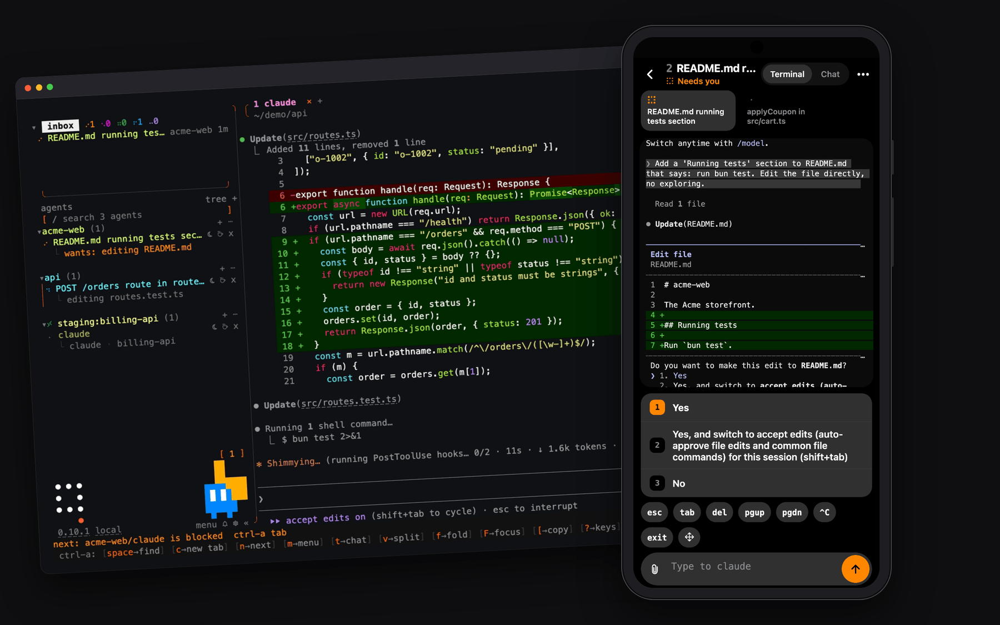
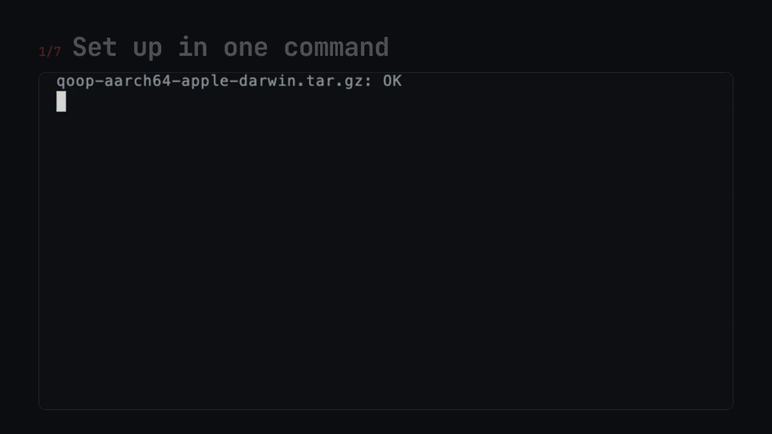

<p align="center">
  <picture>
    <source media="(prefers-color-scheme: light)" srcset="docs/readme/hero-light.png">
    
  </picture>
</p>

<p align="center"><a href="https://qoop.si"><sub>qoop.si</sub></a></p>

<h1 align="center">qoop</h1>

<p align="center">
  Your coding agents in one terminal, and in your pocket.<br>
  It tells you when one needs you. Close the lid; they keep working.
</p>

<p align="center">
  <a href="https://qoop-si.github.io/qoop/">Docs</a> ·
  <a href="https://qoop-si.github.io/qoop/#quick-start">Quick start</a> ·
  <a href="https://qoop-si.github.io/qoop/#keys">Keys</a>
</p>

## Get started

```sh
curl -fsSL https://raw.githubusercontent.com/qoop-si/qoop/main/scripts/install.sh | sh
```

It installs `qoop`, hooks up the agents it finds (Claude Code, Codex and others), lets you
pick a pet and signs you in. Then:

```sh
cd my-project && qoop
```

Type `claude` or `codex` in there. macOS and Linux.

<p align="center">
  
</p>

## What you will see

| | |
|---|---|
| **agent** | Claude Code, Codex and the like, running in a qoop tab. Its dot says what it is doing: breathing while it works, an empty ring when it wants you. |
| **space** | one project: a group of tabs named after it, in its own colour. |
| **server** | another computer over ssh. Its spaces sit beside yours and keep working while your laptop sleeps. |
| **phone** | the same agents on iOS and Android. It buzzes when one asks, finishes or fails; answer from there. |

`ctrl-a tab` jumps to the agent that needs you. `ctrl-q` leaves; everything keeps running.

## Docs

Everything else lives in the [docs](https://qoop-si.github.io/qoop/): keys, spaces and
splits, servers, the phone, qass, hooks, settings, building from source.

## Licence

AGPL-3.0-or-later.
